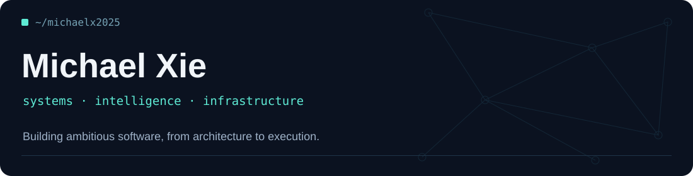

<div align="center">
  

  **Software Engineer · Technical Founder · Builder**

  [Projects](#selected-work) · [Engineering](#engineering--research) · [GitHub](https://github.com/michaelx2025) · [Website](https://mxie.tech)
</div>

## `> whoami`

I build software at the intersection of **distributed systems, data infrastructure, and intelligent agents**. I care about how ideas become reliable products: architecture, data flow, performance, observability, and the messy constraints in between.

Previously, I worked on **Android performance and observability at Snap Inc.** Today, I'm building a startup and exploring systems that combine automation, applied machine learning, and thoughtful product engineering.

```text
current_focus/
├── distributed-systems     → async workloads, data pipelines, observability
├── intelligent-software    → agents, world models, reinforcement learning
├── product-engineering     → APIs, full-stack systems, user-facing tools
└── performance             → latency, reliability, measurement
```

## Engineering & research

| Area | What interests me |
|:--|:--|
| **Distributed systems** | Background workers, asynchronous orchestration, reliable data pipelines, system boundaries |
| **Autonomous agents** | Visual interaction, sandboxed execution, practical agent architectures |
| **Machine learning** | Reinforcement learning, world models, sequential decision-making |
| **Performance engineering** | Latency, smoothness, observability, measurement-driven optimization |
| **Quantitative systems** | Regime modeling, evaluation, data-intensive experimentation |

### Tools I work with

<p>
  
</p>

<details>
<summary><strong>More about my background</strong></summary>

<br />

- **Technical co-founder:** building a data-intensive platform across backend architecture, infrastructure, and product engineering.
- **Former software engineer at Snap Inc.:** worked on Android client performance, rendering, and instrumentation for Snapchat Memories.
- **Engineering mindset:** understand the system, measure what matters, and choose abstractions deliberately.

</details>

---

<div align="center">
  <sub>Build thoughtfully · Measure rigorously · Keep learning</sub>
</div>
